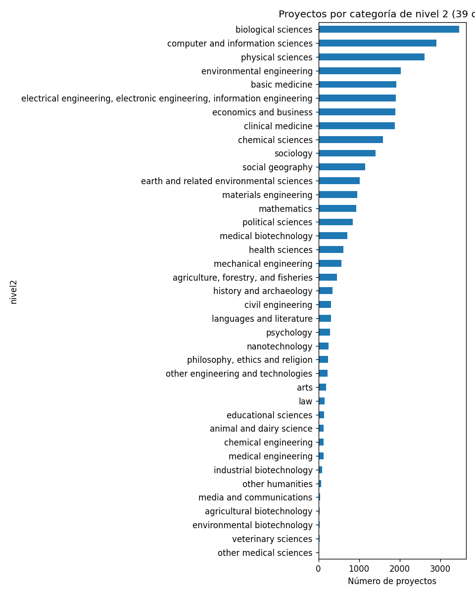
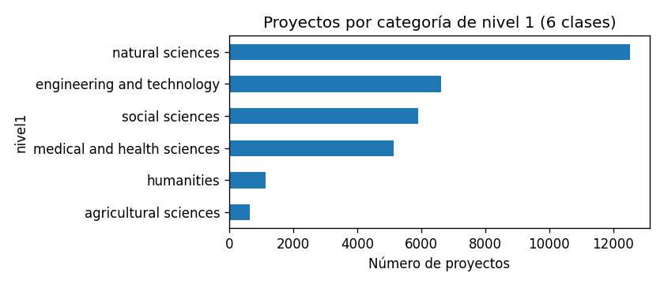
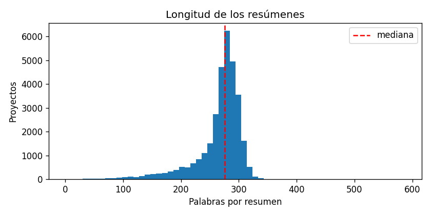
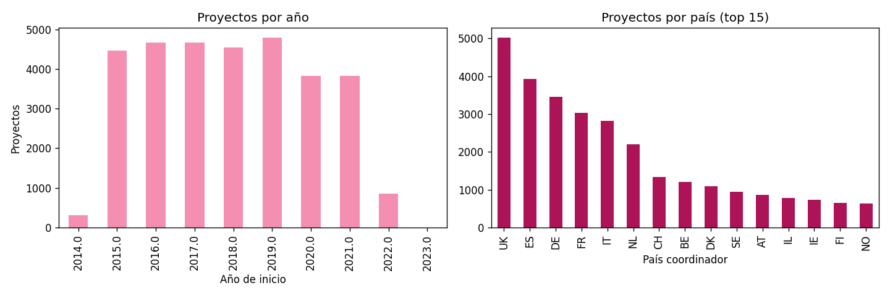
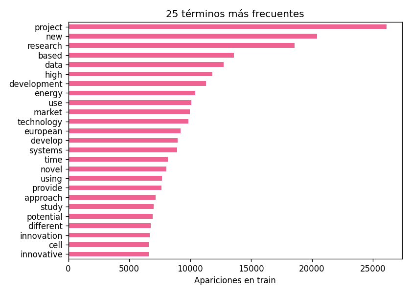
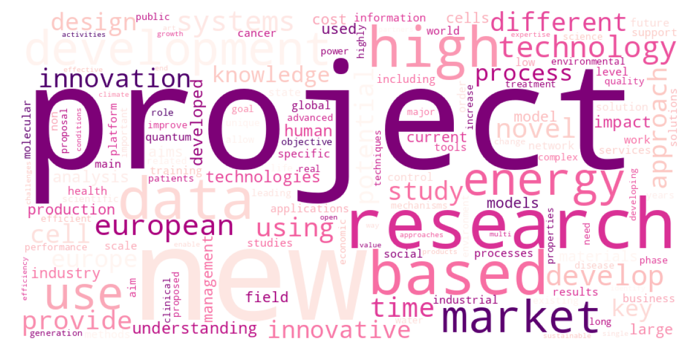

# Análisis temático de proyectos H2020

Proyecto final de Procesamiento de Datos (Máster en Ingeniería de Telecomunicación).

Equipo: Julia Pérez, Lucía Mora, Lucía Fournier y María Sánchez.

> Este README es el informe del proyecto. Cada una redacta la sección de su bloque.

## 1. Problema y conjunto de datos

El objetivo es clasificar proyectos de investigación del programa Horizonte 2020 en su **área
científica** a partir del **resumen** del proyecto. Es un problema de clasificación de texto
multiclase con clases muy desbalanceadas.

Los datos (`projects.xlsx`) contienen **35.378 proyectos** financiados por la Comisión Europea, con
19 variables: identificador, título, resumen, fechas, coste, contribución de la UE, país coordinador,
códigos EuroSciVoc, publicaciones y patentes. Proceden del portal de datos abiertos de la UE
(CORDIS). La jerarquía de categorías está en `SciVocCodes.xlsx` (1.013 términos).

Como entrada de los modelos usamos solo el texto del resumen (`summary`), que no tiene ningún
valor ausente.

## 2. Construcción de la etiqueta (nivel 2 de EuroSciVoc)

EuroSciVoc es una jerarquía de hasta seis niveles. Cada proyecto tiene una lista de códigos, y en
`SciVocCodes.xlsx` cada código tiene su camino completo desde la raíz (`full_code`). Por ejemplo,
`/21/35/155` corresponde a *medical and health sciences / basic medicine / immunology*: el primer
elemento del camino es la categoría de nivel 1 y el segundo, la de nivel 2.

Siguiendo el enunciado:
- recorremos los códigos de cada proyecto **en orden** y nos quedamos con el **primero** que llega
  al nivel 2;
- ignoramos los códigos que no están en la jerarquía o que no llegan al nivel 2;
- descartamos los proyectos sin ningún código válido.

Ejemplo (proyecto 115843): sus códigos son `[155, 56306972, 325, 137, 1609]`. El primero da
*basic medicine* (nivel 2) y *medical and health sciences* (nivel 1). Los demás pertenecen también
a *health sciences* y *biological sciences*; estas áreas las guardamos como **categorías
descartadas** porque las usamos en el análisis de errores (sección 6.4).

| Comprobación | Resultado | Enunciado |
|---|---|---|
| Proyectos conservados | 31.982 (90,40 %) | aprox. 90,31 % |
| Clases de nivel 2 | 39 | — |
| Clases de nivel 1 | 6 | 6 |
| Proyectos con todos sus códigos en la misma área de nivel 2 | 32,2 % | aprox. 32 % |

Conservamos unos 30 proyectos más que la referencia del enunciado. No hemos encontrado la causa,
pero la diferencia (0,09 %) no afecta a los resultados.

El último dato es importante: **dos de cada tres proyectos pertenecen a varias áreas**, y la
etiqueta que predecimos es solo la primera de ellas. Esto pone un techo al rendimiento que puede
alcanzar cualquier modelo.

**Partición.** Dividimos los datos una sola vez en **train (70 %, 22.386)**, **validación (15 %,
4.798)** y **test (15 %, 4.798)**, de forma estratificada por la etiqueta de nivel 2 y con semilla
fija (`random_state=42`). Todo el equipo usa la misma partición (`resultados/particion.csv`). Los
hiperparámetros se eligen con validación y el test solo se usa al final. Para el nivel 1 usamos la
misma partición.

## 3. Análisis exploratorio

**Distribución de las clases.** Las clases están muy desbalanceadas: la mayor (*biological
sciences*, 3.464 proyectos) tiene **385 veces** más proyectos que la menor (*other medical
sciences*, 9 proyectos), y 7 de las 39 clases tienen menos de 100 proyectos. En nivel 1 domina
*natural sciences* (12.523 proyectos), mientras que *agricultural sciences* solo tiene 647.

**Modelo de referencia (baseline).** Un clasificador que siempre predice la clase más frecuente de
train:

| | Accuracy | Macro-F1 |
|---|---|---|
| Nivel 2 (siempre *biological sciences*) | 0,108 | 0,005 |
| Nivel 1 (siempre *natural sciences*) | 0,392 | 0,094 |

En nivel 1 acierta casi el 40 % sin aprender nada, pero su macro-F1 es prácticamente cero. Por eso
usamos el **macro-F1** como métrica principal y no la accuracy.

**Longitud de los resúmenes.** Los resúmenes son bastante homogéneos: mediana de 276 palabras
(máximo 587). Hay 18 resúmenes casi vacíos (menos de 20 palabras); los mantenemos porque son muy
pocos.

**Proyectos por año y por país.** La mayoría de los proyectos empiezan entre 2015 y 2021. Los
países que más proyectos coordinan son Reino Unido, España, Alemania, Francia e Italia.

**Texto.** Este análisis se hace solo con train. Los términos más frecuentes (*project*, *research*,
*new*, *development*) aparecen en casi todos los resúmenes y no distinguen áreas: funcionan como
palabras vacías propias de este corpus, y en el TF-IDF las eliminamos con `max_df`. En cambio, por
clase sí aparece el tema: *cells*, *immune* o *drug* en *basic medicine*, y *climate* o *water* en
ciencias de la tierra.

Al revisar ejemplos por clase encontramos también etiquetas discutibles: un proyecto de tours
turísticos en coche eléctrico con vídeo 360° está etiquetado como *earth and related environmental
sciences*. Es una muestra de que parte de los errores de los modelos se deberá al ruido de las
etiquetas y no a los modelos.

## 4. Representaciones del texto
### 4.1. TF-IDF
<!-- Lucía Mora -->
### 4.2. Word2Vec
<!-- Lucía Fournier -->
### 4.3. Embeddings contextuales (BERT congelado)
<!-- María -->

## 5. Modelos
### 5.1. Modelo de scikit-learn
<!-- Lucía Mora -->
### 5.2. Red neuronal en PyTorch
<!-- Lucía Fournier -->
### 5.3. Fine-tuning de un Transformer
<!-- María -->

## 6. Evaluación comparativa
<!-- Julia -->
### 6.1. Comparación de representaciones y modelos (nivel 2)
### 6.2. Nivel 1 (6 clases)
### 6.3. Incertidumbre del test
### 6.4. Análisis de errores

## 7. Extensión: ¿ayuda la jerarquía?
<!-- Lucía Mora -->

## 8. Conclusiones y limitaciones

## 9. Cómo reproducir los resultados
1. Copiar `projects.xlsx` y `SciVocCodes.xlsx` en `data/`.
2. `pip install -r requirements.txt`
3. Ejecutar los notebooks en orden (01 → 06). El 04 se ejecuta en Google Colab.

## Contribuciones
